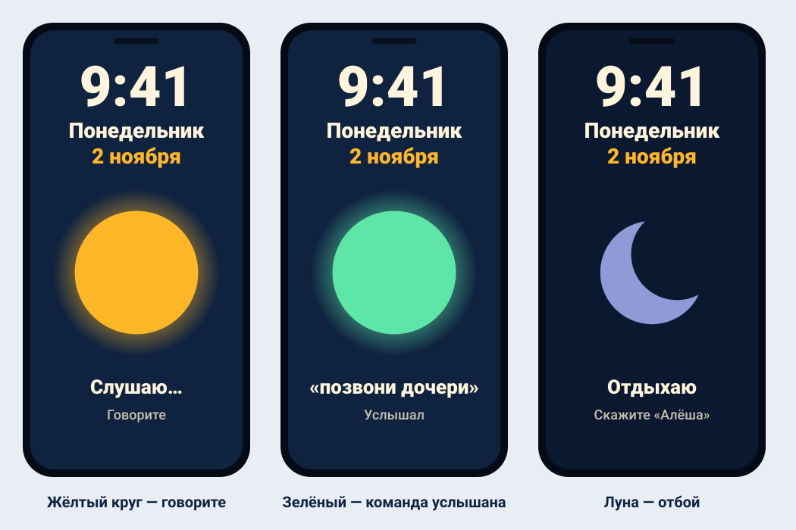
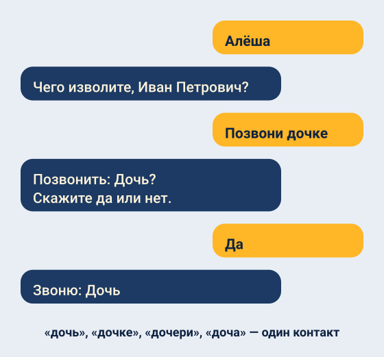
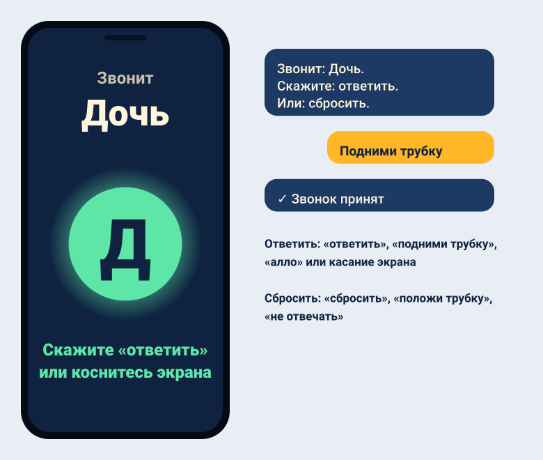
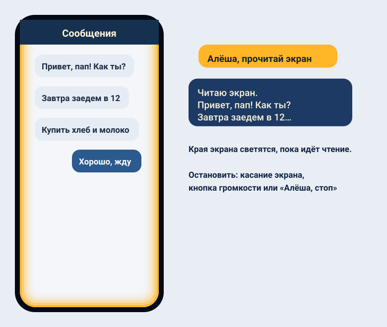
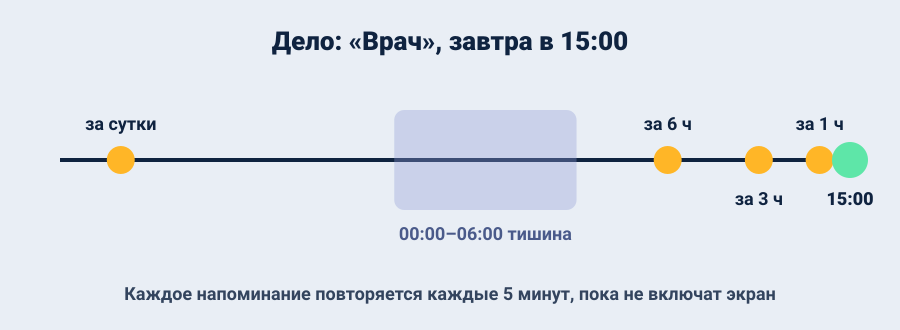
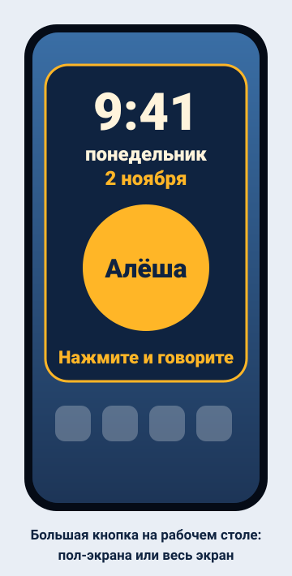
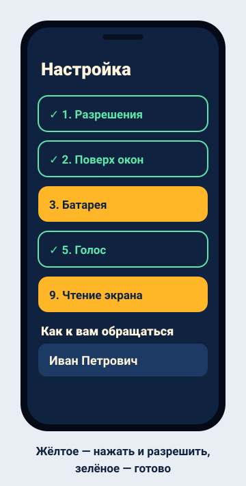

# Помощник Алёша · Alyosha Assistant · 阿廖沙助手

[Русский](#русский) · [English](#english) · [中文](#中文)

Голосовой помощник для Android для пожилого человека, который почти не видит. Всё делается голосом, речь распознаётся без интернета.
A voice assistant for Android for an elderly person who can barely see. Everything works by voice; speech recognition runs offline.
为几乎失明的老人设计的安卓语音助手。一切都用语音完成，语音识别无需联网。

**Скачать · Download · 下载:** [Releases → granpa-phone.apk](https://github.com/Melodiq/granpa-phone-app/releases/latest)

---

## Русский

### Как позвать помощника

| Действие | Что происходит |
|---|---|
| Сказать **«Алёша»** (или «Алексей») | «Чего изволите, Иван Петрович?» — даже при выключенном экране |
| Нажать **боковую кнопку** | «Здравствуйте, Иван Петрович. Слушаю.» |
| **Коснуться экрана** в любом месте или **виджета** | короткий сигнал — можно говорить |

После каждой команды — звук и вибрация: команда услышана. Огромный цветной круг показывает, что происходит: **жёлтый** дышит — говорите, **зелёный** — услышал, **луна** — отдыхает.

### Звонки голосом

- «Позвони дочери», «набери Андрея» — помощник переспрашивает и только потом звонит.
- Падежи и заглавные буквы не важны: «дочь», «дочке», «дочери», «доча» — один контакт.
- **«Отбой»** во время звонка (и пока номер набирается) кладёт трубку.

### Сообщения в Макс

«Напиши дочери» → «Что написать?» → диктуете → «Пишу Дочь: …. Отправить?» → «Да» — помощник сам открывает Макс, находит контакт и отправляет. Нужно включённое чтение экрана; пока идёт отправка, экран не трогать.

### Входящий звонок

Помощник называет звонящего и ждёт ответа — работает и при выключенном экране, и поверх стандартной звонилки.
- **Ответить:** «ответить», «подними трубку», «возьми трубку», «алло» или касание экрана.
- **Сбросить:** «сбросить», «положи трубку», «не отвечать».

Пока помощник слушает, мелодия звонка тише; потом громкость возвращается.

### Чтение экрана

**«Алёша, прочитай экран»** — помощник читает вслух весь текст на экране: сообщения, письма, любое приложение. Края экрана светятся, пока идёт чтение.
Остановить: **касание экрана**, **кнопка громкости** или **«Алёша, стоп»**.

### Время, дата, погода

| Сказать | Ответ |
|---|---|
| «время», «который час» | «Сейчас девять часов сорок одна минута» |
| «какое сегодня число», «какой день недели» | «Сегодня понедельник, второе ноября» |
| «погода» | сейчас и через 1–2 часа |
| «погода на завтра», «погода послезавтра» | от … до … градусов, осадки, сильный ветер |

Погода — Open-Meteo, при сбое — MET Norway. Нужны интернет и геолокация.

### Ежедневник и напоминания

- **«Запиши»** → «Что записать?» → «Когда?» («завтра в три часа дня») → «Записываю… Верно?»
- **«Что у меня сегодня / завтра»**, **«мои записи»**, **«удали запись»**.
- Напоминания — за сутки, за 6, 3 и 1 час; каждое повторяется каждые 5 минут, пока не включат экран.
- **С 00:00 до 06:00 тишина** — ночью о делах не напоминает.

### Отдых

- **«Отбой»** — помощник сворачивается и не здоровается при включении экрана (звонки и напоминания продолжают звучать).
- **«Отбой на полчаса»**, **«отбой на час»** — то же, потом сам возвращается.
- **Пять быстрых касаний по кругу** — отбой на час.

### Виджет

Большая кнопка на рабочем столе на пол-экрана или весь экран: часы, день недели, число. Нажатие — помощник сразу слушает.

### Ещё

- **«Повтори»** — последний ответ ещё раз; **«помощь»** — список команд.
- **Обращение по имени** — задаётся в настройке.
- **Три языка:** русский, английский, китайский — меняются надписи, голос и команды.
- **Эхоподавление:** помощник не слышит собственный голос (если телефон это поддерживает — видно в настройке).
- **Не реагирует на чужую речь:** телевизор и видео на другом языке его не будят; чувствительность к «Алёше» настраивается.

### Установка

1. Скачайте и установите `granpa-phone.apk` (разрешите установку из этого источника).
2. Откройте «Помощник Алёша» — откроется настройка. Нажимайте **жёлтые плашки**, пока все не станут **зелёными**.
3. Введите, как к вам обращаться, выберите спокойный голос.
4. **Чтение экрана** (пункт 9): Специальные возможности → «Алёша: чтение экрана». Если переключатель серый: Настройки → Приложения → помощник → ⋮ → «Разрешить ограниченные настройки».
5. Настройка потом открывается **удержанием пальца на экране 5 секунд**.
6. Виджет: долгое нажатие на рабочем столе → Виджеты → «Алёша — большая кнопка».

**Tecno / Infinix:** автозапуск включить, батарея «Без ограничений», закрепить приложение в недавних.
**Xiaomi / Poco / Redmi:** в разделе Xiaomi настройки — «Всплывающие окна в фоне», «Экран блокировки», «Автозапуск»; батарея «Нет ограничений».

**Советы:** подписывайте контакты коротко («Дочь», «Сын Андрей»); отключите блокировку экрана; если «Алёшу» трудно позвать или он срабатывает от телевизора — поменяйте чувствительность.

---

## English

*Illustrations above show the Russian interface; the English one looks the same.*

### Calling the assistant

| Action | What happens |
|---|---|
| Say **"Alyosha"** or **"Alex"** | "What can I do for you, John?" — even with the screen off |
| Press the **side button** | "Hello, John. I'm listening." |
| **Tap anywhere** on the screen or the **widget** | a beep, then speak |

Every command is confirmed with a sound and a vibration. A big colored circle shows the state: **amber** breathing — speak, **green** — heard, **moon** — resting.

### Features

- **Calls by voice:** "call my daughter" → "Call Daughter? Say yes or no" → "yes". Say **"rest"** during a call (even while dialing) to hang up.
- **Messages in Max:** "message my daughter" → dictate → confirm → the assistant opens Max, finds the contact and sends it (needs screen reading on).
- **Incoming calls:** the caller is announced by name, even with the screen off and over the system call screen. Answer: "answer", "pick up", or tap the screen. Decline: "decline", "hang up".
- **Screen reading:** **"Alyosha, read the screen"** reads all on-screen text aloud while the screen edges glow. Stop: tap the screen, a volume button, or "Alyosha, stop".
- **Time, date, weather:** "what time is it", "what's the date", "weather", "weather tomorrow", "weather the day after tomorrow". Weather: Open-Meteo, MET Norway as a fallback.
- **Notes and reminders:** "take a note" → what → when → confirm. Reminders 24, 6, 3 and 1 hour before, repeated every 5 minutes until the screen is turned on. **Quiet from midnight to 6 AM.**
- **Rest:** "rest", "rest for half an hour", "rest for an hour"; **five quick taps on the circle** — rest for an hour.
- **Widget:** a half-screen or full-screen button with the clock and date.
- **Also:** "repeat", "help"; your name in greetings; Russian, English and Chinese; echo cancellation so the assistant doesn't hear itself; ignores TV and videos in other languages; adjustable wake-word sensitivity.

### Installation

1. Download and install `granpa-phone.apk`.
2. Open the app, tap every amber tile in setup until all are green.
3. Enter your name and pick a calm voice.
4. **Screen reading** (step 9): Accessibility → "Alyosha: screen reading". If the switch is greyed out: Settings → Apps → the assistant → ⋮ → "Allow restricted settings".
5. Reopen setup later by **holding a finger on the main screen for 5 seconds**.

**Tecno / Infinix:** turn on Autostart, battery "No restrictions", lock the app in recent apps. **Xiaomi / Poco / Redmi:** in the Xiaomi section allow background pop-ups, lock-screen display and autostart.

---

## 中文

*上方插图为俄语界面，中文界面布局相同。*

### 呼叫助手

| 操作 | 结果 |
|---|---|
| 说 **「阿廖沙」** 或 **「小助手」** | 「王爷爷，有什么吩咐？」——熄屏时也可以 |
| 按 **侧键** | 「王爷爷，您好。我在听。」 |
| **点击屏幕** 任意位置或 **小部件** | 提示音后说话 |

每条命令都有声音和振动确认。大彩色圆圈显示状态：**黄色**呼吸——请说话，**绿色**——已听到，**月亮**——休息中。

### 功能

- **语音打电话：** 「给女儿打电话」→「给女儿打电话吗？」→「是」。通话中（包括拨号时）说 **「休息」** 挂断。
- **Max 消息：** 「给女儿发消息」→ 口述内容 → 确认 → 助手打开 Max、找到联系人并发送（需开启读屏）。
- **来电：** 朗读来电人姓名，熄屏时和系统来电界面之上也可用。接听：「接听」或点击屏幕；挂断：「挂断」「不接」。
- **读屏：** **「阿廖沙，读屏幕」** 朗读屏幕上的全部文字，屏幕边缘发光。停止：点击屏幕、音量键或「阿廖沙，停」。
- **时间、日期、天气：** 「几点了」「今天几号」「天气」「明天天气」「后天天气」。天气来自 Open-Meteo，备用 MET Norway。
- **记事和提醒：** 「记一下」→ 内容 → 时间 → 确认。事件前 24、6、3、1 小时提醒，每 5 分钟重复直到点亮屏幕。**0:00 至 6:00 不提醒。**
- **休息：** 「休息」「休息半小时」「休息一小时」；**快速点击圆圈五次**——休息一小时。
- **小部件：** 半屏或全屏的大按钮，显示时钟和日期。
- **其他：** 「重复」「帮助」；问候时称呼您的名字；俄语、英语、中文；回声消除，助手听不到自己的声音；不会被电视和外语视频唤醒；可调唤醒灵敏度。

### 安装

1. 下载并安装 `granpa-phone.apk`。
2. 打开应用，点击设置中所有黄色方块直到变绿。
3. 填写称呼，选择平静的语音。
4. **读屏**（第 9 项）：无障碍 →「阿廖沙：读屏」。若开关为灰色：设置 → 应用 → 本助手 → ⋮ →「允许受限制的设置」。
5. 之后在主屏幕上 **按住 5 秒** 打开设置。

---

## Tech

Kotlin, plain Android views. Offline speech recognition: [Vosk](https://alphacephei.com/vosk/) (small Russian, English and Chinese models) with a restricted command grammar and per-word confidence filtering; microphone input uses the voice-communication source with Android's acoustic echo canceler. Speech output: system text-to-speech. Screen reading: an accessibility service with a glowing edge overlay. Weather: [Open-Meteo](https://open-meteo.com/), fallback [MET Norway](https://api.met.no/). GitHub Actions builds the APK on every push to `main` and publishes it to Releases.
